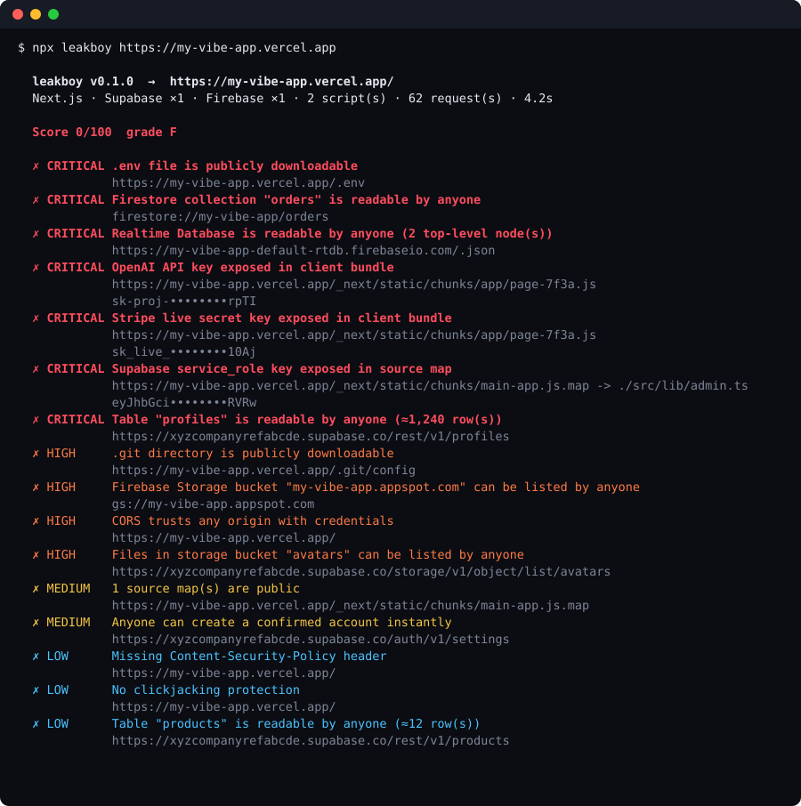

# leakboy 🤠

**Temukan kebocoran di aplikasi *vibe-coded* kamu sebelum orang lain menemukannya.**

🇬🇧 [Read in English](README.md)

```sh
git clone https://github.com/Emil-02/leakboy && cd leakboy
npm ci && npm run build:cli
node packages/leakboy/dist/cli.js https://aplikasi-kamu.vercel.app
```

<p align="center"></p>

Aplikasimu jadi dalam satu akhir pekan berkat Lovable, Bolt, v0, Cursor, atau Claude, dan sudah jalan. Sekarang cek dulu:
apakah kunci Stripe ikut terkirim ke browser setiap pengunjung? Apakah tabel `profiles` bisa dibaca siapa saja yang
memegang anon key? Apakah file `.env` ikut ter-deploy? Kebocoran seperti ini sering ditemukan di aplikasi
*vibe-coded*, dan penyerang sudah memindai hal-hal ini secara otomatis.

leakboy melihat aplikasimu **dengan cara penyerang melihatnya, tapi hanya membaca (read-only)**. Ia mengunduh semua
yang diunduh browser, termasuk chunk lazy-load dan source map. Lalu ia mengambil konfigurasi Supabase/Firebase dari
bundle dan menanyakan ke backend apa saja yang bisa dilihat publik. Hasilnya berupa **skor 0–100**, temuan dalam
bahasa sederhana, dan contoh perbaikan siap salin untuk setiap temuan.

## Yang diperiksa

| | Pemeriksaan | Cara |
|---|---|---|
| 🔑 | **Secret di kode klien** | 31 jenis secret di bundle JS, script inline, HTML, dan source map: Supabase `service_role`/`sb_secret_`, Stripe, OpenAI, Anthropic, Gemini, AWS, GitHub, Telegram, **Midtrans**, **Xendit**, private key, URL database, dan lainnya. Semua nilai disamarkan. |
| 🗄️ | **RLS Supabase** | Hanya memakai anon/publishable key dari bundle. Untuk setiap tabel, leakboy menjalankan `select … limit 1` lalu melaporkan **jumlah baris dan nama kolom, tidak pernah isi barisnya**. Bucket storage dan pengaturan konfirmasi email saat sign-up juga diperiksa. |
| 🔥 | **Rules Firebase** | Realtime Database, koleksi Firestore yang dipakai di kode, dan listing Cloud Storage. |
| 🗺️ | **Source map** | File `.map` publik, termasuk yang "tersembunyi" (tanpa komentar `sourceMappingURL`). |
| 📂 | **File terekspos** | `.env*`, `.git/config`, `.npmrc`, dump SQL, `docker-compose.yml`, `.DS_Store`. Isi file divalidasi dulu, jadi fallback SPA yang selalu menjawab 200 tidak dianggap temuan. |
| 🧱 | **Header** | HTTPS, HSTS, CSP, perlindungan clickjacking, `nosniff`, dan CORS yang memantulkan origin apa pun disertai credentials. |

## Pemakaian

Paket npm-nya belum dipublikasikan. Build CLI dari source lalu tautkan secara lokal:

```sh
git clone https://github.com/Emil-02/leakboy.git
cd leakboy
npm ci
npm run build:cli
alias leakboy="node $PWD/packages/leakboy/dist/cli.js"
```

Lalu:

```sh
leakboy https://aplikasi-kamu.vercel.app      # pindai aplikasi yang sudah deploy
leakboy ./dist                                # pindai folder build sebelum deploy
leakboy aplikasi.com --verbose                # dengan penjelasan dan cara perbaikan
leakboy aplikasi.com --fail-under 80          # exit 1 kalau skor < 80 (untuk CI)
leakboy aplikasi.com --markdown laporan.md --sarif leakboy.sarif
```

`npx leakboy …` akan berfungsi setelah paketnya dipublikasikan ke npm. Butuh Node.js 22.19 atau lebih baru.

**Skor:** critical −40, high −20, medium −8, low −3. **Satu temuan critical saja langsung membuat grade F.**

## Versi web & GitHub Action

- Web: **[leakboy-web-et8r.vercel.app](https://leakboy-web-et8r.vercel.app)**. Tempel URL, lalu dapat laporan dan badge untuk README.
- GitHub Action: lihat [README bahasa Inggris](README.md#github-action).

## Keamanan & etika

- **Read-only:** tidak pernah menulis, menghapus, mendaftar akun, atau memanggil fungsi RPC.
- **Tidak ada data yang dibawa keluar:** isi baris tidak pernah disimpan atau ditampilkan, dan semua secret disamarkan.
- **Tidak pernah memakai kunci istimewa** seperti `service_role`. Kunci seperti itu hanya dilaporkan.

**Pindai hanya aplikasi milikmu sendiri atau yang kamu punya izin untuk mengujinya.** Lihat [ETHICS.md](ETHICS.md).

## Lisensi

[MIT](LICENSE) © Emil Rahmat
