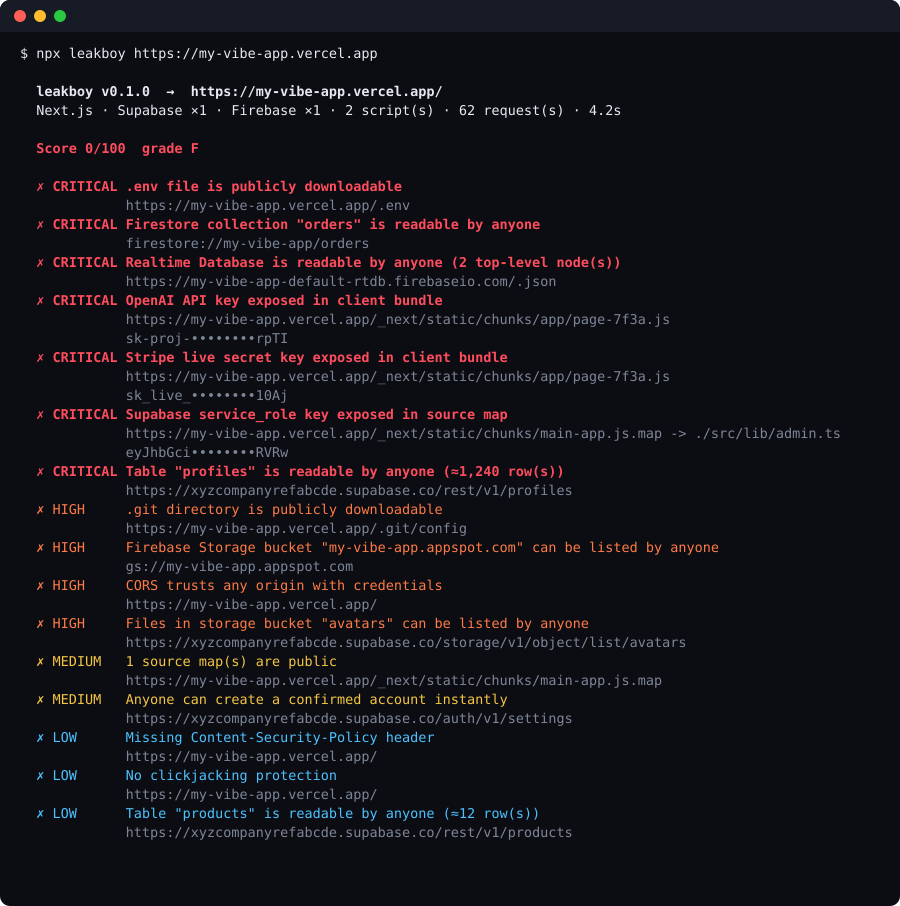

# leakboy 🤠

[](https://jaga-card.vercel.app/r/Emil-02/leakboy)

**Find the leaks in your vibe-coded app before someone else does.**

[](https://github.com/Emil-02/leakboy/actions/workflows/ci.yml)
[](https://github.com/Emil-02/leakboy/blob/main/LICENSE)

🇮🇩 [Baca dalam Bahasa Indonesia](https://github.com/Emil-02/leakboy/blob/main/README.id.md)

> **Using an AI coding agent?** Install [`jaga-skill`](https://github.com/Emil-02/jaga/tree/main/skills/jaga-skill) with `npx jaga-skill init` — a gate that stops the agent before commit/deploy when secrets or personal data are detected. `leakboy` is part of the checks behind it.

```sh
git clone https://github.com/Emil-02/leakboy && cd leakboy
npm ci && npm run build:cli
node packages/leakboy/dist/cli.js https://your-app.vercel.app
```

<p align="center"></p>
<p align="center"><sub>Real output from the bundled <a href="https://github.com/Emil-02/leakboy/tree/main/lab">lab app</a>, with hostnames renamed. Secrets are masked by leakboy itself.</sub></p>

You built the app in a weekend with Lovable, Bolt, v0, Cursor or Claude. It works. But does it ship your
Stripe key to every visitor? Is your `profiles` table readable by anyone holding the public anon key? Did
`.env` get deployed? These leaks keep showing up in vibe-coded apps, and attackers already scan for them.

leakboy looks at your app **the way an attacker does, but read-only**. It downloads what the browser downloads,
follows lazy-loaded chunks and source maps, takes the Supabase/Firebase config straight from your bundle, and then asks
your backend what anyone can see. The answer is a **0–100 score**, plain-English findings and a copy-paste fix for each one.

## What it checks

| | Check | How |
|---|---|---|
| 🔑 | **Secrets in client code** | 31 secret types in JS bundles, inline scripts, HTML and source maps: Supabase `service_role`/`sb_secret_`, Stripe, OpenAI, Anthropic, Gemini, Groq, OpenRouter, AWS, GitHub, Slack, Telegram, SendGrid, Resend, Midtrans, Xendit, private keys, database URLs… Every value is masked. |
| 🗄️ | **Supabase RLS** | Uses only the anon/publishable key from your bundle. It lists tables from the public schema (or from `.from("…")` calls), does `select … limit 1` on each and reports **row counts and column names, never rows**. It also checks storage buckets and whether sign-up auto-confirms emails. |
| 🔥 | **Firebase rules** | Realtime Database (`/.json?shallow=true`), Firestore collections used in your code, and Cloud Storage listing. |
| 🗺️ | **Source maps** | Public `.map` files, including "hidden" ones without a `sourceMappingURL` comment, which let anyone rebuild your original source. |
| 📂 | **Exposed files** | `.env*`, `.git/config`, `.npmrc`, SQL dumps, `docker-compose.yml`, `.DS_Store`. A file only counts if its content really matches, so SPA fallbacks that answer 200 for every path don't trigger false positives. |
| 🧱 | **Headers** | HTTPS, HSTS, CSP, clickjacking protection, `nosniff`, and CORS that reflects any origin with credentials. |

Works with Next.js (pages and app router), Vite/React, Nuxt, SvelteKit, Astro, Remix, CRA, Angular and plain HTML.

## Install & use

The npm package is not published yet. Build the CLI from source and link it locally:

```sh
git clone https://github.com/Emil-02/leakboy.git
cd leakboy
npm ci
npm run build:cli
alias leakboy="node $PWD/packages/leakboy/dist/cli.js"
```

Then:

```sh
leakboy https://your-app.vercel.app            # scan a deployed app
leakboy ./dist                                 # scan a build folder before deploying (.next, dist, build, out)
leakboy your-app.com --verbose                 # with explanations and fixes
leakboy your-app.com --fail-under 80           # exit 1 when the score is below 80 (CI)
leakboy your-app.com --markdown report.md --sarif leakboy.sarif
leakboy your-app.com --only supabase,secrets   # secrets, supabase, firebase, exposure, headers
leakboy your-app.com --json | jq .score
```

`npx leakboy …` will work once the package is published to npm. Requires Node.js 22.19 or newer. Exit codes: `0` ok, `1` below `--fail-under`, `2` error.

### Scoring

Every finding costs points: critical **40**, high **20**, medium **8**, low **3**, info **0**. **Any critical finding means
grade F** (score capped at 49), because a readable `users` table is a breach no matter how good your headers are.
Grades: A ≥ 90, B ≥ 80, C ≥ 65, D ≥ 50, F below that. The JSON output lists every deduction.

## Web version

`apps/web` is a Next.js site: paste a URL and get the report with a shareable link and a README badge. Hosted at
**[leakboy-web-et8r.vercel.app](https://leakboy-web-et8r.vercel.app)**, or deploy your own:

[](https://vercel.com/new/clone?repository-url=https%3A%2F%2Fgithub.com%2FEmil-02%2Fleakboy&root-directory=apps%2Fweb&project-name=leakboy)


```markdown
[](https://leakboy-web-et8r.vercel.app/?url=https://your-app.com)
```

The web version only scans public hosts on ports 80/443. Private and internal addresses are blocked, including after
redirects and DNS rebinding. Scans are rate-limited and results are cached for 10 minutes.

## GitHub Action

Scan every preview deploy and fail the PR when the score drops:

```yaml
- uses: Emil-02/leakboy@v0.1.0
  id: leakboy
  with:
    target: ${{ steps.deploy.outputs.preview-url }}   # or ./dist
    fail-under: 80
    sarif: leakboy.sarif
- uses: github/codeql-action/upload-sarif@v3
  if: always()
  with:
    sarif_file: leakboy.sarif
```

The Markdown report is written to the job summary. Outputs: `score`, `grade`, `report`.

## Library

```ts
import { scan, formatMarkdown } from "leakboy";

const result = await scan("https://your-app.com", { only: ["supabase", "secrets"] });
console.log(result.score.grade, result.findings.length);
```

## Safety & ethics

leakboy is built to be safe to point at production:

- **Read-only.** Only `GET`/`HEAD` requests, plus Supabase Storage's read-only `list` endpoint (which is a `POST`
  in their API). It never inserts, updates, deletes, signs up or calls RPC functions.
- **No data leaves the target.** Row contents are never stored or printed: only counts and column names. Secrets are
  masked before they reach any output. A test makes sure that no secret or row value shows up in the JSON, SARIF,
  Markdown or terminal output.
- **Bounded.** Request, byte and time budgets on every scan, and it never touches third-party CDNs or analytics.
- **Never uses privileged keys.** If it finds a `service_role` key, it reports it and does not use it.

**Only scan apps you own or have permission to test.** See [ETHICS.md](https://github.com/Emil-02/leakboy/blob/main/ETHICS.md).

## Try it on the lab

The repo includes a deliberately vulnerable app with fake Supabase and Firebase backends, plus a hardened twin:

```sh
git clone https://github.com/Emil-02/leakboy && cd leakboy
npm ci && npm run build:cli
npm run lab                                # vulnerable :4000, hardened :4001
node packages/leakboy/dist/cli.js http://127.0.0.1:4000   # grade F
node packages/leakboy/dist/cli.js http://127.0.0.1:4001   # grade A
```

## Contributing

New secret rules, framework hints and probes are very welcome. See [CONTRIBUTING.md](https://github.com/Emil-02/leakboy/blob/main/CONTRIBUTING.md). Adding a secret
rule takes about ten lines.

## Related

- [envboy](https://github.com/Emil-02/envboy): back up, restore and guard every `.env` across your repos, so they never end up in a deploy.
- [gh-spruce](https://github.com/Emil-02/gh-spruce): Lighthouse for your GitHub profile.

## License

[MIT](https://github.com/Emil-02/leakboy/blob/main/LICENSE) © Emil Rahmat
